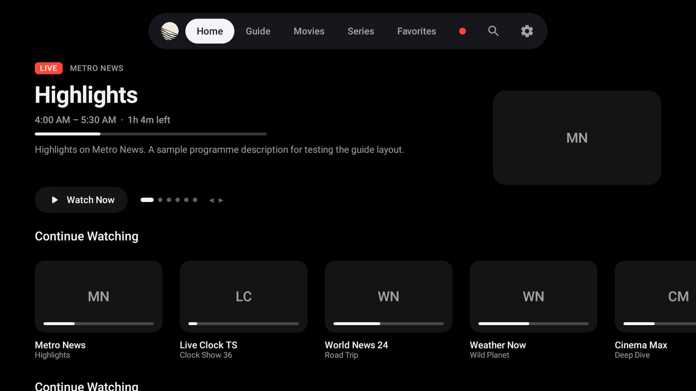
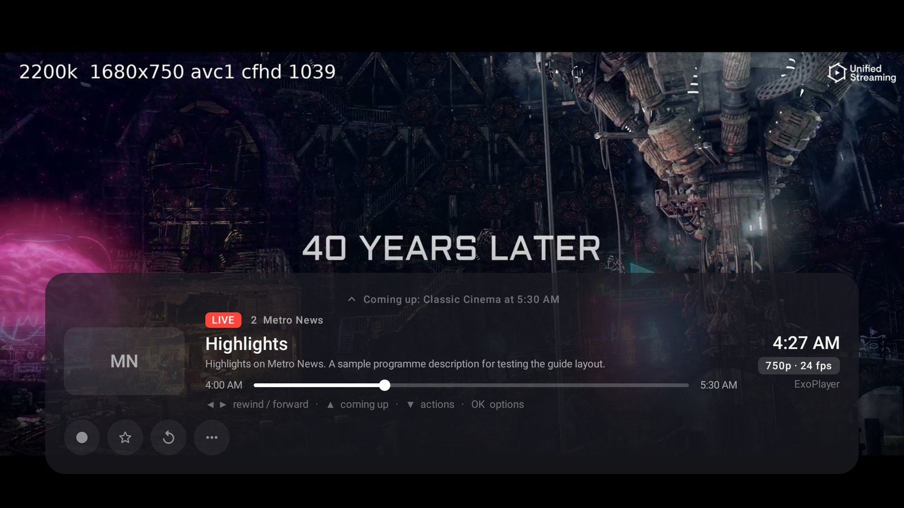
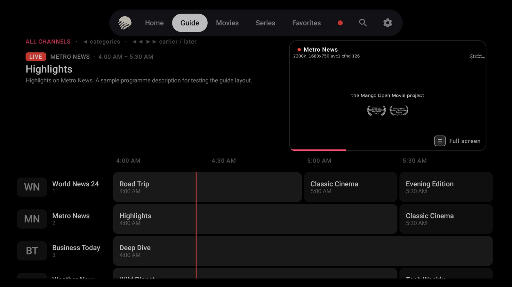
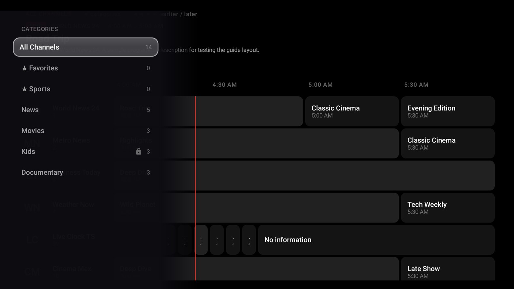
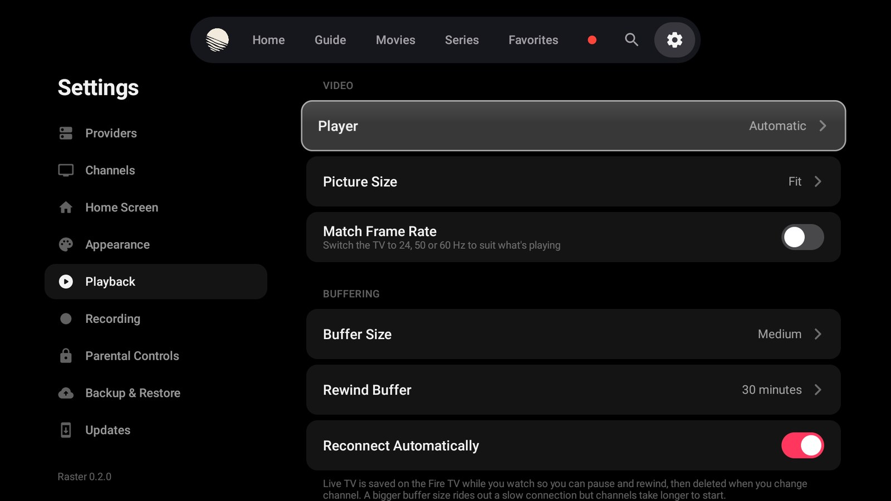

<p align="center">
  
</p>

<p align="center">
  A fast, good-looking IPTV player for <b>Fire TV</b> and <b>Android TV</b>.<br>
  Live channels, a proper TV guide, movies and series — built for the remote.<br>
  <a href="../../releases/latest"><b>Download the latest release</b></a>
</p>

<p align="center">
  
  
  
  
</p>

<p align="center">
  
</p>

---

## Highlights

| | |
|---|---|
| **Rewind live TV** | Live channels are buffered on the device, so you can pause and rewind any MPEG-TS channel — no provider catch-up needed. The timeline shows exactly how far back you can go. |
| **A real TV guide** | A time grid with catch-up markers, reminders and recording, categories that slide in from the left, and the channel you're watching playing in the header. |
| **Built for the remote** | Every screen is designed around the D-pad: focus lands where you expect, channel numbers work, and nothing needs a keyboard. |
| **One connection** | Rewind, the mini player and zapping all share a single stream, so providers that allow one connection just work. |
| **Set up from your phone** | Scan a QR code to type your provider details on your phone, and back up or restore your setup the same way. |

## Screenshots

<table>
  <tr>
    <td width="50%"><br><sub><b>Player.</b> OK opens the info card: rewind on the timeline, what's coming up, quick actions and history.</sub></td>
    <td width="50%"><br><sub><b>Guide.</b> The channel you're watching keeps playing in the header while you browse.</sub></td>
  </tr>
  <tr>
    <td width="50%"><br><sub><b>Categories.</b> ◀ at the start of the guide slides in your groups and favourites lists.</sub></td>
    <td width="50%"><br><sub><b>Settings.</b> Grouped into clear sections, every option a press or two away.</sub></td>
  </tr>
</table>

## Features

### 📺 Live TV
- Xtream Codes and M3U playlists (several providers, switch any time), XMLTV guides (gzip fine)
- Pause and rewind live TV from a local buffer (up to 2 hours), or the provider's archive on catch-up channels
- Rewind timeline with a time bubble, programme boundaries and a one-press **Go Live**
- Info card with episode details, **Coming Up**, Record, Favourite, Audio, Subtitles and Start Over
- Recently watched channels, previous channel, number-key tuning, Multiview (2 or 4 at once)
- "Up next" and "recording soon" pop-ups, sleep timer, automatic reconnect

### 🗓️ Guide
- Time grid that keeps your place in time when moving between channels
- Catch-up programmes highlighted with ↺, past programmes faded
- Reminders and recordings straight from the grid; ◀◀ ▶▶ move an hour at a time
- Categories panel with favourites lists and provider groups

### 🎬 Movies & Series
- Browse by category with posters, details and seasons
- Resume where you left off, automatic next episode, Continue Watching on Home

### 🏠 Home
- Rotating banner of what's on now on your favourites
- Rows you choose and order yourself: Continue Watching, favourites lists, recordings, recently added
- Left at the start of any row jumps back to the top

### ⏺️ Recording
- Record now or schedule from the guide, to internal storage or USB
- Works with plain TS and HLS streams

### 🎛️ Playback
- ExoPlayer with hardware decoding, automatic fallback to VLC for difficult streams
- Buffer size, rewind buffer length, audio passthrough (Dolby / DTS), preferred audio and subtitle languages
- Subtitle size, colour and background
- Match frame rate (24p films, 50 Hz channels)

### 🎨 Personal
- Raster theme with a cream accent, plus Cool Dark and Pure Black (for OLED)
- Accent colours, sounds and motion each switchable
- Rename, renumber or hide channels; favourites lists you can reorder
- Parental PIN for groups, channels and Settings
- In-app updates

## Remote controls

| Key | Watching full screen | With the info card open (press OK) |
|---|---|---|
| **▲ ▼** | Change channel | ▲ Coming up · ▼ Actions, then history |
| **◀** | Channel list (◀ again: categories) | Rewind |
| **▶** | Show info | Fast-forward |
| **OK** | Open the info card | Options (or jump, while scrubbing) |
| **⏯** | Pause / resume live TV | Pause / resume |
| **◀◀ ▶▶** | Rewind / fast-forward | Rewind / fast-forward |
| **☰** | Options | Options |
| **0–9** | Tune by channel number (0 alone: previous channel) | |
| **Back** | Shrink to the corner window | Close the card |

While browsing with the corner window, **☰** (or Back on the tab bar) brings it back full screen and **⏯** closes it.
In the Guide, **◀** at the current time opens the categories and **◀◀ ▶▶** move an hour earlier or later.

## Install

Raster isn't in an app store. Download the APK for your device from the [latest release](../../releases/latest).
Most Fire TV devices need **`armeabi-v7a`** (32-bit apps, even on 64-bit hardware).

**On the Fire TV:** *Settings › My Fire TV › Developer options* → allow apps from unknown sources
(or allow the Downloader app), then open the APK.

**With ADB** (enable ADB debugging in the same menu):

```sh
adb connect <fire-tv-ip>:5555
adb install -r raster-0.3.0-armeabi-v7a.apk
adb shell cmd package compile -m speed -f tv.raster.app   # recommended, see below
```

The last command compiles the app ahead of time. Sideloaded apps otherwise run partly interpreted until
Fire OS gets round to compiling them, and the interface is noticeably slower until then.

Every APK is signed with Raster's release key, and GitHub publishes a SHA-256 checksum for each file.

## Updating

Raster updates itself from **Settings › Updates**. By default it follows this repository.
Updates come only over `https://`, and an APK is installed only when its SHA-256 matches. The update source can be changed to either:

- a public GitHub repository (`owner/name`) whose releases carry the APKs. Raster picks the file whose name
  contains its ABI and checks it against GitHub's published digest.
- an `https://` link to a JSON file you host anywhere, with each APK's SHA-256:

  ```json
  {
    "versionCode": 3,
    "versionName": "0.3.0",
    "notes": "What's new",
    "apks": {
      "armeabi-v7a": { "url": "raster-0.3.0-armeabi-v7a.apk", "sha256": "…64 hex characters…" }
    }
  }
  ```
  APK links may be relative to the JSON file.

The first update asks you to allow Raster to install apps. Android then closes Raster once, and the update
offer comes back when you reopen it.

## How it's built

| | |
|---|---|
| UI | Kotlin, Jetpack Compose for TV (tv-material), a tvOS-style floating tab bar |
| Playback | Media3 ExoPlayer 1.10 (HLS, DASH, progressive TS) with LibVLC 3.7 fallback |
| Live rewind | One provider connection written to disk in chunks; times come from the stream's own clock (PCR), so bursty providers stay accurate |
| Data | Guide, catalogues, progress and recordings in SQLite; settings in JSON |
| Network | OkHttp; images through Coil |

## Known limits

- Xtream movies and series follow the API spec but haven't been tested against many live panels.
- Recordings of HLS streams whose audio is a separate track come out video-only.
- Each recording needs its own connection to the provider.
- Voice search can't start Alexa from inside the app; it uses the keyboard's dictation instead.

## Privacy and terms

Raster is free.

- [Privacy policy](PRIVACY.md)
- [Terms of use](TERMS.md)

---

<p align="center"><sub>Raster is a player only. It doesn't provide any channels or content; use it with services you're entitled to.</sub></p>
